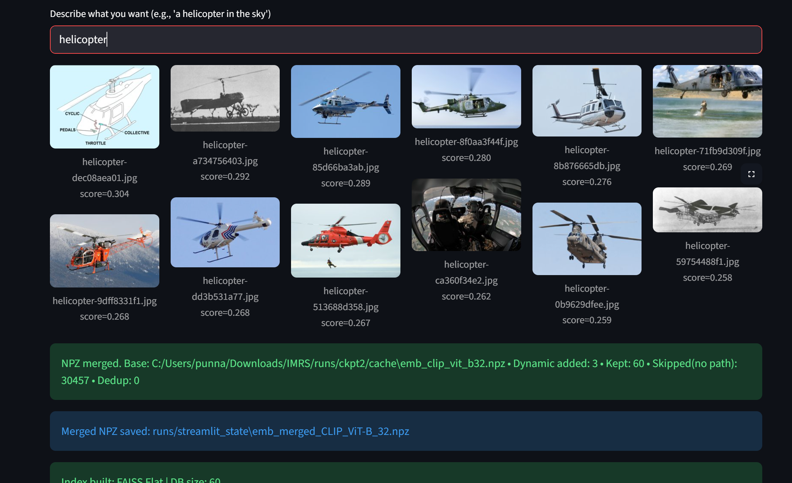
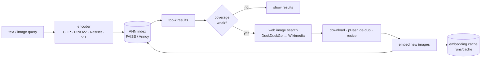

# IMRS — Self-Expanding Image Retrieval

[](https://github.com/OWNER/imrs/actions/workflows/ci.yml)

Text→image and image→image search over **Caltech-256** that **notices when it doesn't know a
concept and teaches itself**: if no image in the collection matches a query well enough, it
pulls a small, de-duplicated batch of images from the web, embeds them and adds them to the live index.

- **Encoders:** CLIP (ViT-B/32, B/16, L/14), DINOv2, ResNet-50, ViT-B/16, plus an optional fine-tuned metric-learning adapter
- **Indexes:** FAISS Flat / HNSW / IVF-Flat / IVF-PQ and Annoy behind one interface, benchmarked on quality *and* speed
- **Evaluation:** leakage-free protocol, ANN recall vs exact search, recall–QPS curves, calibrated expansion trigger
- **App:** Streamlit UI for search, bulk concept expansion and dataset clean-up; tested and containerised



## Results

<!-- RESULTS:START -->
_Run `imrs bench` + `imrs report` to populate._
<!-- RESULTS:END -->

## How it works



* **Every vector is L2-normalised**, so inner product = cosine similarity across all backends.
* **The embedding cache** (`runs/cache/emb_<backbone>.npz`) stores vectors *with* their image paths. It is
  incremental (only new images get embedded) and doubles as the app's persistent state: on start the app
  re-lists the files on disk and looks them up in the cache, so there's no separate snapshot to drift out of sync.
* **The expansion trigger** fires when fewer than `min_good` results clear a cosine threshold. Instead of a
  hand-picked number, `imrs calibrate` measures it: each class's text prompt is run against the full
  gallery (concept present) and against the gallery with that class removed (concept missing), and the
  threshold that best separates the two is reported with its ROC-AUC.

### Evaluation protocol

| | |
|---|---|
| Gallery | all ~29.8k images in 256 classes (`257.clutter` excluded, as is standard) after per-class pHash de-duplication |
| Queries | 2,000, stratified across classes; each query is removed from its own result list |
| Relevance | same class |
| Metrics | mAP@10, P@10, R@10, nDCG@10 (normalised by class size in the gallery), Hit@1 |
| ANN quality | neighbour recall@10 against exact search on the same vectors, separating index error from embedding error |
| Speed | single-query p50 latency, batched QPS, build time, index size (CPU) |
| Fine-tuning | **class-disjoint split**: the adapter trains on 128 classes and is evaluated only on the other 128 |

## Quickstart

```bash
python -m venv .venv && source .venv/bin/activate     # Windows: .venv\Scripts\activate
pip install torch torchvision --index-url https://download.pytorch.org/whl/cpu   # or a CUDA build
pip install -e ".[app,preprocess,dev]"

python scripts/download_caltech256.py --out data      # ~1.2 GB
imrs preprocess --raw_root data/256_ObjectCategories --data_root data/caltech256_proc
streamlit run app/streamlit_app.py
```

Paths come from the environment (or CLI flags), never from the code:

| variable | default |
|---|---|
| `IMRS_DATA_ROOT` | `data/caltech256_proc` |
| `IMRS_RUNS_DIR` | `runs` |
| `IMRS_DEVICE` | auto (`cuda` → `mps` → `cpu`) |
| `IMRS_USER_AGENT` | identifies the web fetcher to Wikimedia; add your contact URL |

Docker: `docker build -t imrs . && docker run -p 8501:8501 -v $PWD/data:/app/data -v $PWD/runs:/app/runs imrs`

## Reproducing the benchmarks

```bash
imrs bench --backbones clip_vit_b32 resnet50 vit_b16 dinov2_vits14       # quality + speed, all indexes
imrs sweep --backbone clip_vit_b32                                        # recall-vs-QPS curves
imrs finetune --backbone clip_vit_b32 --loss supcon                       # adapter on 128 train classes
imrs bench --backbones clip_vit_b32 clip_vit_b32_ft --eval_classes heldout --indexers flat
imrs calibrate --backbone clip_vit_b32                                    # expansion trigger
imrs report                                                               # -> runs/bench/REPORT.md + plots
```

Other commands: `imrs search --text "a red sports car"`, `imrs expand "electric scooter" "rubik's cube"`,
`imrs embed --include_dynamic`. Run `imrs <command> -h` for options.

## Project layout

```
src/imrs/
  config.py      settings from env vars
  data.py        dataset listing, preprocessing (resize/pad, pHash de-dup), class-disjoint & query splits
  models.py      encoders + residual projection adapter
  embeddings.py  batched embedding with failure masks, incremental path-keyed cache
  index.py       FAISS / Annoy wrappers, exact search, ID-mapped VectorStore
  metrics.py     AP@k, P@k, R@k, nDCG@k, neighbour recall
  evaluate.py    benchmark, ANN sweeps, expansion-trigger calibration
  finetune.py    SupCon / batch-hard triplet training with P×K sampling
  expansion.py   web image search, download, de-dup, coverage policy
  report.py      markdown leaderboard + plots
  cli.py         `imrs` command
app/streamlit_app.py
tests/           34 tests; synthetic data + a fake encoder, so they run in seconds offline
```

## Design notes

* **Why an adapter, not full fine-tuning?** Training a small residual MLP on cached embeddings takes seconds
  on a CPU, can be compared fairly against the frozen backbone, and its last layer is zero-initialised so it
  starts as an exact identity and can't do worse than the backbone at step 0.
* **Why a class-disjoint split?** Evaluating a metric-learning model on the classes it trained on measures
  memorisation, not retrieval. This is the standard protocol for CUB / SOP / In-Shop.
* **Why remove near-duplicates before evaluating?** A copy of the query sitting in the gallery is a free hit.
* **Additions vs removals in the app:** additions go straight into the live index (Flat / HNSW) or trigger a
  cheap rebuild (IVF / Annoy). Removals rebuild the index from the stored vectors, which never requires re-embedding.

## Limitations & next steps

* Web expansion trusts the search engine's labels; images aren't verified before indexing. A CLIP
  text-image agreement filter on downloads would reduce noise.
* Relevance is class-level. Caltech-256 has no fine-grained or instance-level ground truth.
* Benchmarks are CPU-only. On GPU the encoders, not the indexes, dominate latency.
