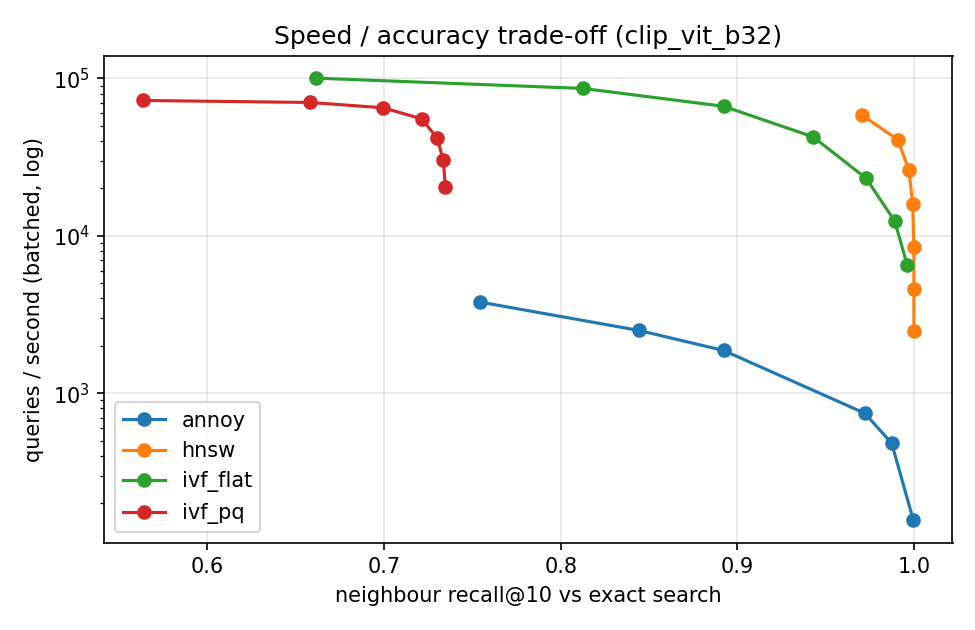

## Retrieval benchmark

| backbone | indexer | eval_classes | query_expansion | mAP@10 | P@10 | R@10 | nDCG@10 | Hit@1 | ann_recall@10 | latency_ms_p50 | qps_batch | build_s | index_mb |
|---|---|---|---|---|---|---|---|---|---|---|---|---|---|
| dinov2_vits14 | flat | all | 2 | 0.862 | 0.881 | 0.085 | 0.886 | 0.909 | – | 2.66 | 4,201 | 0.01 | 43.4 |
| dinov2_vits14 | ivf_pq | all | 0 | 0.852 | 0.877 | 0.084 | 0.883 | 0.903 | 0.810 | 0.12 | 31,311 | 3.78 | 3.4 |
| dinov2_vits14 | ivf_flat | all | 0 | 0.846 | 0.872 | 0.084 | 0.880 | 0.913 | 0.979 | 0.07 | 59,925 | 0.94 | 44.6 |
| dinov2_vits14 | flat | all | 0 | 0.842 | 0.869 | 0.084 | 0.877 | 0.909 | 1.000 | 2.60 | 9,059 | 0.01 | 43.4 |
| dinov2_vits14 | hnsw | all | 0 | 0.842 | 0.869 | 0.084 | 0.877 | 0.909 | 1.000 | 0.12 | 19,572 | 5.27 | 51.0 |
| dinov2_vits14 | annoy | all | 0 | 0.834 | 0.859 | 0.083 | 0.869 | 0.903 | 0.917 | 0.29 | 1,873 | 2.53 | 62.8 |
| clip_vit_b32 | flat | all | 2 | 0.757 | 0.787 | 0.075 | 0.796 | 0.834 | – | 2.35 | 7,060 | 0.04 | 57.8 |
| vit_b16 | ivf_pq | all | 0 | 0.738 | 0.771 | 0.074 | 0.781 | 0.824 | 0.689 | 0.08 | 48,190 | 4.98 | 4.8 |
| vit_b16 | ivf_flat | all | 0 | 0.733 | 0.771 | 0.074 | 0.783 | 0.829 | 0.955 | 0.14 | 27,926 | 1.67 | 89.0 |
| clip_vit_b32 | ivf_flat | all | 0 | 0.731 | 0.772 | 0.074 | 0.786 | 0.839 | 0.943 | 0.08 | 42,662 | 1.11 | 59.4 |
| clip_vit_b32 | ivf_pq | all | 0 | 0.731 | 0.771 | 0.074 | 0.783 | 0.826 | 0.721 | 0.07 | 57,734 | 3.86 | 3.9 |
| vit_b16 | flat | all | 0 | 0.731 | 0.770 | 0.074 | 0.782 | 0.831 | 1.000 | 5.86 | 4,820 | 0.02 | 86.7 |
| vit_b16 | hnsw | all | 0 | 0.730 | 0.770 | 0.074 | 0.782 | 0.831 | 1.000 | 0.30 | 9,347 | 8.99 | 94.4 |
| clip_vit_b32 | hnsw | all | 0 | 0.727 | 0.769 | 0.074 | 0.783 | 0.834 | 0.999 | 0.16 | 15,289 | 5.19 | 65.5 |
| clip_vit_b32 | flat | all | 0 | 0.727 | 0.769 | 0.074 | 0.783 | 0.834 | 1.000 | 3.75 | 5,276 | 0.37 | 57.8 |
| clip_vit_b32 | annoy | all | 0 | 0.697 | 0.737 | 0.070 | 0.755 | 0.823 | 0.852 | 0.38 | 2,410 | 2.58 | 77.3 |
| vit_b16 | annoy | all | 0 | 0.687 | 0.725 | 0.069 | 0.742 | 0.811 | 0.804 | 0.39 | 2,393 | 1.98 | 106.6 |
| resnet50 | ivf_flat | all | 0 | 0.672 | 0.719 | 0.069 | 0.733 | 0.793 | 0.935 | 0.65 | 8,662 | 3.98 | 236.9 |
| resnet50 | flat | all | 0 | 0.672 | 0.721 | 0.069 | 0.735 | 0.795 | 1.000 | 14.42 | 1,955 | 0.06 | 231.3 |
| resnet50 | hnsw | all | 0 | 0.672 | 0.721 | 0.069 | 0.735 | 0.795 | 1.000 | 0.51 | 4,864 | 15.23 | 238.9 |
| resnet50 | ivf_pq | all | 0 | 0.670 | 0.716 | 0.068 | 0.728 | 0.773 | 0.667 | 0.53 | 18,681 | 18.23 | 9.4 |
| resnet50 | annoy | all | 0 | 0.606 | 0.655 | 0.062 | 0.679 | 0.765 | 0.669 | 2.02 | 463 | 8.47 | 251.7 |
| clip_vit_b32_ft | flat | heldout | 0 | 0.804 | 0.839 | 0.080 | 0.847 | 0.880 | 1.000 | 1.73 | 13,427 | 0.01 | 29.7 |
| clip_vit_b32 | flat | heldout | 0 | 0.768 | 0.807 | 0.077 | 0.819 | 0.865 | 1.000 | 2.00 | 13,204 | 0.05 | 29.7 |

## ANN sweep (sweep_clip_vit_b32)

## Expansion trigger calibration

| backbone | min_good | n_classes | roc_auc | best_threshold | tpr_at_best | fpr_at_best | text_to_image_P@10 |
|---|---|---|---|---|---|---|---|
| clip_vit_b32 | 3 | 256 | 0.922 | 0.327 | 0.793 | 0.082 | 0.945 |